  <!-- Clean Sans + Mono Hero Banner (Adaptive Dark / Light) -->
  <picture>
    <source media="(prefers-color-scheme: dark)" srcset="./assets/hero-dark.svg">
    <source media="(prefers-color-scheme: light)" srcset="./assets/hero-light.svg">
    
  </picture>

   

  <!-- Animated Typing Font Effect (JetBrains Mono) -->
  <picture>
    <source media="(prefers-color-scheme: dark)" srcset="https://readme-typing-svg.demolab.com?font=JetBrains+Mono&amp;weight=600&amp;size=16&amp;duration=3200&amp;pause=1100&amp;color=22C55E&amp;center=true&amp;vCenter=true&amp;multiline=false&amp;repeat=true&amp;width=780&amp;height=36&amp;lines=%3E+Security+Operations+%2F%2F+Blue+Team+%26+Wazuh+SIEM;%3E+Cloud+%26+DevOps+%2F%2F+AWS+EC2+%26+RDS+%C2%B7+Render+%C2%B7+Docker+%C2%B7+Nginx;%3E+Full-Stack+%26+UI%2FUX+%2F%2F+Spring+Boot+%C2%B7+React+%C2%B7+TypeScript+%C2%B7+Figma;%3E+Detection+as+Code+%2F%2F+Suricata+%C2%B7+tshark+%C2%B7+Sigma+Rules+%40+HCMUTE">
    <source media="(prefers-color-scheme: light)" srcset="https://readme-typing-svg.demolab.com?font=JetBrains+Mono&amp;weight=600&amp;size=16&amp;duration=3200&amp;pause=1100&amp;color=16A34A&amp;center=true&amp;vCenter=true&amp;multiline=false&amp;repeat=true&amp;width=780&amp;height=36&amp;lines=%3E+Security+Operations+%2F%2F+Blue+Team+%26+Wazuh+SIEM;%3E+Cloud+%26+DevOps+%2F%2F+AWS+EC2+%26+RDS+%C2%B7+Render+%C2%B7+Docker+%C2%B7+Nginx;%3E+Full-Stack+%26+UI%2FUX+%2F%2F+Spring+Boot+%C2%B7+React+%C2%B7+TypeScript+%C2%B7+Figma;%3E+Detection+as+Code+%2F%2F+Suricata+%C2%B7+tshark+%C2%B7+Sigma+Rules+%40+HCMUTE">
    
  </picture>

  

    
    &nbsp;
    
    &nbsp;
    
    &nbsp;
    
  

 

<!-- 01 // FEATURED PROJECTS -->
<picture>
  <source media="(prefers-color-scheme: dark)" srcset="./assets/sec-projects-dark.svg">
  <source media="(prefers-color-scheme: light)" srcset="./assets/sec-projects-light.svg">
  
</picture>

  

  <a href="https://github.com/louishoang711/WISE">
    <picture>
      <source media="(prefers-color-scheme: dark)" srcset="./assets/card-wise-dark.svg">
      <source media="(prefers-color-scheme: light)" srcset="./assets/card-wise-light.svg">
      
    </picture>
  </a>
  &nbsp;
  <a href="https://github.com/louishoang711/Purple-team-SOC-Lab">
    <picture>
      <source media="(prefers-color-scheme: dark)" srcset="./assets/card-soc-dark.svg">
      <source media="(prefers-color-scheme: light)" srcset="./assets/card-soc-light.svg">
      
    </picture>
  </a>

  <a href="https://github.com/ProjectWEB-Team/Project_WEB">
    <picture>
      <source media="(prefers-color-scheme: dark)" srcset="./assets/card-web-dark.svg">
      <source media="(prefers-color-scheme: light)" srcset="./assets/card-web-light.svg">
      
    </picture>
  </a>
  &nbsp;
  <a href="https://github.com/anphan991/e-gov-signature-project">
    <picture>
      <source media="(prefers-color-scheme: dark)" srcset="./assets/card-egov-dark.svg">
      <source media="(prefers-color-scheme: light)" srcset="./assets/card-egov-light.svg">
      
    </picture>
  </a>

  
  &nbsp;
  
  &nbsp;
  

 

<!-- 02 // TECH STACK & ARSENAL -->
<picture>
  <source media="(prefers-color-scheme: dark)" srcset="./assets/sec-arsenal-dark.svg">
  <source media="(prefers-color-scheme: light)" srcset="./assets/sec-arsenal-light.svg">
  
</picture>

  

<picture>
  <source media="(prefers-color-scheme: dark)" srcset="./assets/arsenal-dark.svg">
  <source media="(prefers-color-scheme: light)" srcset="./assets/arsenal-light.svg">
  
</picture>

  

  

    
    
    
    
    
    
    
    
  

  

    
    
    
    
    
    
    
    
  

 

<!-- 03 // TELEMETRY & ACTIVITY -->
<picture>
  <source media="(prefers-color-scheme: dark)" srcset="./assets/sec-activity-dark.svg">
  <source media="(prefers-color-scheme: light)" srcset="./assets/sec-activity-light.svg">
  
</picture>

  

  <picture>
    <source media="(prefers-color-scheme: dark)" srcset="https://github-readme-streak-stats.herokuapp.com/?user=louishoang711&amp;background=0B0F17&amp;border=1E293B&amp;stroke=1E293B&amp;ring=22C55E&amp;fire=38BDF8&amp;currStreakNum=F8FAFC&amp;sideNums=E2E8F0&amp;currStreakLabel=22C55E&amp;sideLabels=94A3B8&amp;dates=64748B&amp;border_radius=12">
    <source media="(prefers-color-scheme: light)" srcset="https://github-readme-streak-stats.herokuapp.com/?user=louishoang711&amp;background=FFFFFF&amp;border=E2E8F0&amp;stroke=E2E8F0&amp;ring=16A34A&amp;fire=0284C7&amp;currStreakNum=0F172A&amp;sideNums=1E293B&amp;currStreakLabel=16A34A&amp;sideLabels=475569&amp;dates=64748B&amp;border_radius=12">
    
  </picture>

 

<picture>
  <source media="(prefers-color-scheme: dark)" srcset="https://raw.githubusercontent.com/louishoang711/louishoang711/snake-output/snake-dark.svg">
  <source media="(prefers-color-scheme: light)" srcset="https://raw.githubusercontent.com/louishoang711/louishoang711/snake-output/snake.svg">
  
</picture>

  

<!-- Footer Banner -->
<picture>
  <source media="(prefers-color-scheme: dark)" srcset="./assets/footer-dark.svg">
  <source media="(prefers-color-scheme: light)" srcset="./assets/footer-light.svg">
  
</picture>
