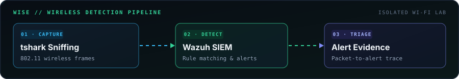

  <!-- Animated Cyber-SOC Hero Banner (Adaptive Dark / Light) -->
  <picture>
    <source media="(prefers-color-scheme: dark)" srcset="./assets/hero-dark.svg">
    <source media="(prefers-color-scheme: light)" srcset="./assets/hero-light.svg">
    
  </picture>

   

  <!-- Animated Typing Font Effect (JetBrains Mono) -->
  <picture>
    <source media="(prefers-color-scheme: dark)" srcset="https://readme-typing-svg.demolab.com?font=JetBrains+Mono&amp;weight=600&amp;size=17&amp;duration=3200&amp;pause=1100&amp;color=34D399&amp;center=true&amp;vCenter=true&amp;multiline=false&amp;repeat=true&amp;width=760&amp;height=38&amp;lines=%3E+Security+Operations+%2F%2F+Blue+Team+Analyst+in+Training;%3E+From+Wireless+Packets+(tshark)+to+Wazuh+Alerts;%3E+Threat+Detection+%2F%2F+Packet+Triage+%2F%2F+Java+Backend;%3E+Building+Hands-On+SOC+Labs+%40+HCMUTE">
    <source media="(prefers-color-scheme: light)" srcset="https://readme-typing-svg.demolab.com?font=JetBrains+Mono&amp;weight=600&amp;size=17&amp;duration=3200&amp;pause=1100&amp;color=059669&amp;center=true&amp;vCenter=true&amp;multiline=false&amp;repeat=true&amp;width=760&amp;height=38&amp;lines=%3E+Security+Operations+%2F%2F+Blue+Team+Analyst+in+Training;%3E+From+Wireless+Packets+(tshark)+to+Wazuh+Alerts;%3E+Threat+Detection+%2F%2F+Packet+Triage+%2F%2F+Java+Backend;%3E+Building+Hands-On+SOC+Labs+%40+HCMUTE">
    
  </picture>

  

    
    &nbsp;
    
    &nbsp;
    
    &nbsp;
    
  

 

<!-- 01 // FEATURED PROJECTS -->
<picture>
  <source media="(prefers-color-scheme: dark)" srcset="./assets/sec-projects-dark.svg">
  <source media="(prefers-color-scheme: light)" srcset="./assets/sec-projects-light.svg">
  
</picture>

  

<table width="100%">
  <tr>
    <td width="50%" valign="top">
      

        <strong><a href="https://github.com/louishoang711/WISE">WISE · Wireless Detection Lab</a></strong> 
        Isolated Wi-Fi security lab capturing 802.11 wireless frames with <code>tshark</code> and correlating suspicious device activity into actionable <code>Wazuh</code> alerts.
      

      

        
        
        
      

      

        <a href="https://github.com/louishoang711/WISE">Repository ↗</a> &nbsp;·&nbsp; <a href="https://github.com/louishoang711/WISE/tree/main/docs/04-ket-qua">Lab results ↗</a>
      

    </td>
    <td width="50%" valign="top">
      

        <strong><a href="https://github.com/louishoang711/Purple-team-SOC-Lab">Purple Team SOC Lab</a></strong> 
        Hands-on Security Operations lab built for continuous monitoring, attack simulation telemetry, and blue-team alert triage practice.
      

      

        
        
        
      

      

        <a href="https://github.com/louishoang711/Purple-team-SOC-Lab">Repository ↗</a>
      

    </td>
  </tr>
  <tr>
    <td width="50%" valign="top">
      

        <strong><a href="https://github.com/anphan991/e-gov-signature-project">e-Gov Signature Project</a></strong> 
        Digital signature prototype for signing and verifying PDF documents in public administrative workflows with cryptographic integrity checks.
      

      

        
        
      

      

        <a href="https://github.com/anphan991/e-gov-signature-project">Repository ↗</a>
      

    </td>
    <td width="50%" valign="top">
      

        <strong><a href="https://github.com/ProjectWEB-Team/Project_WEB">Project WEB</a></strong> 
        Collaborative Java web application developed with structured MVC architecture, authentication flows, and team version control.
      

      

        
        
      

      

        <a href="https://github.com/ProjectWEB-Team/Project_WEB">Repository ↗</a> &nbsp;·&nbsp; <a href="https://github.com/louishoang711/spring-security-vd123">Spring Security Lab ↗</a>
      

    </td>
  </tr>
</table>

  
<code>▸ WISE Detection Pipeline — How packets become alerts</code>

   
  <picture>
    <source media="(prefers-color-scheme: dark)" srcset="./assets/wise-pipeline-dark.svg">
    <source media="(prefers-color-scheme: light)" srcset="./assets/wise-pipeline-light.svg">
    
  </picture>

 

<!-- 02 // SECURITY & DEV ARSENAL -->
<picture>
  <source media="(prefers-color-scheme: dark)" srcset="./assets/sec-arsenal-dark.svg">
  <source media="(prefers-color-scheme: light)" srcset="./assets/sec-arsenal-light.svg">
  
</picture>

  

<table width="100%">
  <tr>
    <td width="50%" valign="top">
      <strong><code>// BLUE TEAM &amp; SOC</code></strong>  
      
      
      
      
      
    </td>
    <td width="50%" valign="top">
      <strong><code>// BACKEND &amp; ENGINEERING</code></strong>  
      
      
      
      
      
      
      
    </td>
  </tr>
</table>

 

<!-- 03 // LIVE TELEMETRY & ACTIVITY -->
<picture>
  <source media="(prefers-color-scheme: dark)" srcset="./assets/sec-activity-dark.svg">
  <source media="(prefers-color-scheme: light)" srcset="./assets/sec-activity-light.svg">
  
</picture>

  

  <picture>
    <source media="(prefers-color-scheme: dark)" srcset="https://github-readme-streak-stats.herokuapp.com/?user=louishoang711&amp;background=090F18&amp;border=1E293B&amp;stroke=1E293B&amp;ring=34D399&amp;fire=38BDF8&amp;currStreakNum=F0FDF4&amp;sideNums=E2E8F0&amp;currStreakLabel=34D399&amp;sideLabels=94A3B8&amp;dates=64748B&amp;border_radius=12">
    <source media="(prefers-color-scheme: light)" srcset="https://github-readme-streak-stats.herokuapp.com/?user=louishoang711&amp;background=F8FAFC&amp;border=CBD5E1&amp;stroke=E2E8F0&amp;ring=059669&amp;fire=0284C7&amp;currStreakNum=0F172A&amp;sideNums=1E293B&amp;currStreakLabel=059669&amp;sideLabels=475569&amp;dates=64748B&amp;border_radius=12">
    
  </picture>

 

<picture>
  <source media="(prefers-color-scheme: dark)" srcset="https://raw.githubusercontent.com/louishoang711/louishoang711/snake-output/snake-dark.svg">
  <source media="(prefers-color-scheme: light)" srcset="https://raw.githubusercontent.com/louishoang711/louishoang711/snake-output/snake.svg">
  
</picture>

  

<!-- Animated Footer Banner -->
<picture>
  <source media="(prefers-color-scheme: dark)" srcset="./assets/footer-dark.svg">
  <source media="(prefers-color-scheme: light)" srcset="./assets/footer-light.svg">
  
</picture>
