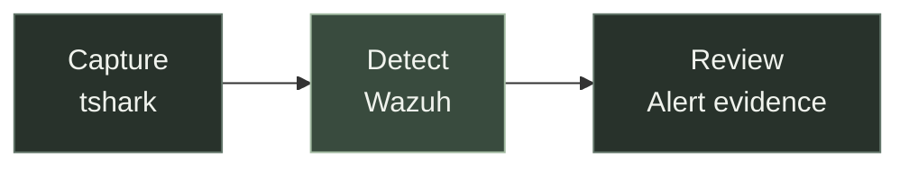

  <h1>Louis</h1>
  
<strong>Security Operations · Blue Team</strong>

  
I build labs to understand what happened on a network and what an alert can tell me about it.

## WISE · Wireless Detection Lab

My team built an isolated Wi-Fi lab to see how suspicious activity on real devices shows up in packet captures and Wazuh alerts.

[Explore WISE ↗](https://github.com/louishoang711/WISE) · [Read the lab results ↗](https://github.com/louishoang711/WISE/tree/main/docs/04-ket-qua)

## Selected projects

**[Purple Team SOC Lab ↗](https://github.com/louishoang711/Purple-team-SOC-Lab)**  
A purple team lab focused on SOC monitoring and detection.

**[e-Gov Signature Project ↗](https://github.com/anphan991/e-gov-signature-project)**  
A prototype for signing and verifying PDFs in public administrative services.

**[Project WEB ↗](https://github.com/ProjectWEB-Team/Project_WEB)**  
A collaborative Java web project.

  
Contribution Snake

   
  <picture>
    <source media="(prefers-color-scheme: dark)" srcset="https://raw.githubusercontent.com/louishoang711/louishoang711/snake-output/snake-dark.svg">
    
  </picture>

