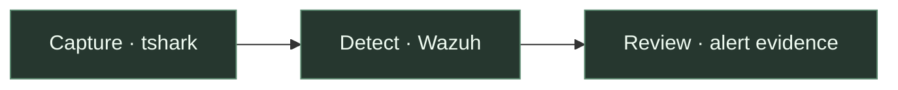

  
  
<strong>Security Operations · Blue Team</strong>

  
From wireless packets to alerts I can investigate.

### `~/projects`

<table width="100%">
<tr><td width="800">
  <strong><a href="https://github.com/louishoang711/WISE">WISE · Wireless Detection Lab</a></strong> 
  Wireless packet capture with tshark and detection with Wazuh. 
   &nbsp; <a href="https://github.com/louishoang711/WISE/tree/main/docs/04-ket-qua">Lab results ↗</a>
</td></tr>
</table>

<table width="100%">
<tr><td width="800">
  <strong><a href="https://github.com/louishoang711/Purple-team-SOC-Lab">Purple Team SOC Lab</a></strong> 
  Lab for SOC monitoring and detection practice. 
  
</td></tr>
</table>

<table width="100%">
<tr><td width="800">
  <strong><a href="https://github.com/anphan991/e-gov-signature-project">e-Gov Signature Project</a></strong> 
  A prototype for signing and verifying PDFs for public services. 
  
</td></tr>
</table>

<table width="100%">
<tr><td width="800">
  <strong><a href="https://github.com/ProjectWEB-Team/Project_WEB">Project WEB</a></strong> 
  Collaborative Java web project. 
  
</td></tr>
</table>

  
How WISE detects suspicious activity

### `~/activity`

<picture>
  <source media="(prefers-color-scheme: dark)" srcset="https://raw.githubusercontent.com/louishoang711/louishoang711/snake-output/snake-dark.svg">
  
</picture>
